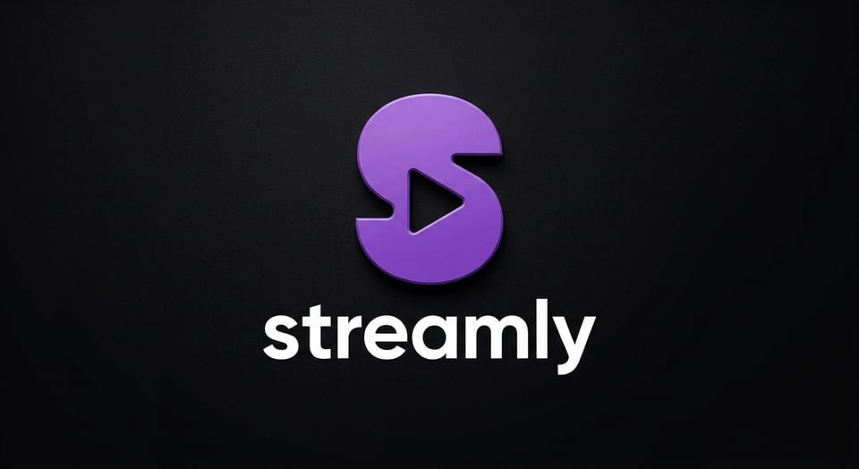

<p align="center"></p>

<h1 align="center">STREAMLY</h1>

<p align="center">
  <strong>Encontrá cualquier película o serie y enterate en qué plataforma verla, según tu región.</strong>
</p>

<p align="center">
  
  
  
  
  
  
</p>

<p align="center">
  Proyecto de la cursada 2026 de <strong>Metodologías Ágiles</strong>, UTN-FRLP · Grupo N° 6
</p>

---

## Contenido

- [¿Qué es?](#qué-es)
- [Funcionalidades](#funcionalidades)
- [Equipo](#equipo)
- [Puesta en marcha](#puesta-en-marcha)
- [Estructura](#estructura)
- [Pantallas](#pantallas)
- [Panel de administración](#panel-de-administración)
- [API](#api)
- [Documentación](#documentación)

## ¿Qué es?

Un buscador unificado que permite encontrar cualquier película o serie y saber, en un solo lugar, en qué plataforma de streaming está disponible según la región geográfica del usuario, con redireccionamiento directo a esa plataforma para empezar a ver el contenido.

**¿Para quién?** Consumidores habituales de streaming que tienen 2 o más suscripciones activas (Netflix, Disney+, HBO Max, Prime Video, etc.) y que experimentan fricción real al decidir qué ver: saltan entre apps, no recuerdan en cuál tienen un título, o se topan con bloqueos regionales inesperados.

## Funcionalidades

| Funcionalidad   | Qué ofrece                                                                                          |
| --------------- | --------------------------------------------------------------------------------------------------- |
| Búsqueda        | Películas y series por texto, tipo, año, género, actor o director                                   |
| Disponibilidad  | En qué plataformas está cada título en tu región, con enlace directo y comparación entre regiones   |
| Watchlist       | Títulos guardados, con aviso por mail cuando uno pasa a estar disponible en tu región               |
| Mis plataformas | Elegir las plataformas contratadas y buscar solo en ellas                                           |
| Cine            | Cartelera argentina, próximos estrenos y funciones por ciudad (ver [docs/cine.md](docs/cine.md))    |
| Cooltura        | Eventos presenciales en La Plata (ver [docs/cooltura.md](docs/cooltura.md))                         |
| Cuenta          | Registro, inicio de sesión, recuperar y cambiar la contraseña, cambiar el mail y eliminar la cuenta |
| Administración  | Métricas de uso y listado de usuarios, solo para cuentas con rol de administrador                   |

## Equipo

| Integrantes       |
| ----------------- |
| Sofia Lara Goszko |
| Silvia Romero     |
| Pablo Rella       |
| Joaquin Montes    |
| Pedro Fiuza       |

## Puesta en marcha

**Requisitos:** Node >= 22.23.2 y npm >= 11.

```bash
npm install
npm run dev     # API en :3000 y web en :5173
npm run check   # lint + formato + tests
```

Copiar `apps/api/.env.example` como `apps/api/.env` y completar las claves de Supabase (las pasa quien administra el proyecto) y `TMDB_API_KEY`. El resto de las variables son para funciones puntuales:

| Variable                         | Para qué sirve                                                                      |
| -------------------------------- | ----------------------------------------------------------------------------------- |
| `STREAMING_AVAILABILITY_API_KEY` | Deep links de la ficha y sincronización diaria de disponibilidad                    |
| `RESEND_API_KEY`, `RESEND_FROM`  | Mails de avisos de la watchlist                                                     |
| `SMTP_*`, `MAIL_FROM`            | Mails de la cuenta (recuperar la contraseña y cambiar el mail)                      |
| `ALLEVENTS_API_KEY`              | Eventos de Cooltura                                                                 |
| `TRUST_PROXY`                    | Proxies de confianza, para detectar bien la región (ver [API](#búsqueda-y-títulos)) |

Los jobs programados (`syncAvailability` y `sendNotifications`) corren solo con `NODE_CRON_RUN=true`, en una sola instancia del despliegue; por defecto quedan desactivados. En local se ejecutan a mano con `npm run job -w apps/api -- <nombre>`. El detalle está en [apps/api/README.md](apps/api/README.md).

## Estructura

Monorepo con npm workspaces, en JavaScript (sin TypeScript).

```
apps/
  api/        Express 5: routes → controllers → services → repositories / integrations
  web/        React 19 + Vite + Tailwind CSS v4, organizado por funcionalidad (features/)
packages/
  shared/     Esquemas Zod y constantes que usan la API y la web
supabase/
  migrations/ Esquema de la base
```

- Los datos viven en Supabase y solo la API accede a ellos; la web habla únicamente con la API.
- Catálogo y disponibilidad: TMDB (con datos de JustWatch). Deep links a cada plataforma: Streaming Availability API.
- Las convenciones del proyecto (capas, nombres, idioma, commits) están en [AGENTS.md](./AGENTS.md).

## Pantallas

| Ruta                      | Sesión | Descripción                                                                                          |
| ------------------------- | :----: | ---------------------------------------------------------------------------------------------------- |
| `/`                       |        | Búsqueda de películas y series                                                                       |
| `/cartelera`              |        | Películas que TMDB clasifica actualmente en cartelera argentina                                      |
| `/cooltura`               |        | Eventos presenciales en La Plata                                                                     |
| `/titulos/:tipo/:tmdbId`  |        | Detalle de un título con su disponibilidad en la región y, con sesión, la comparación entre regiones |
| `/watchlist`              |   sí   | Títulos guardados por el usuario                                                                     |
| `/mis-plataformas`        |   sí   | Elegir las plataformas contratadas                                                                   |
| `/perfil`                 |   sí   | Mail y región de la cuenta, plataformas propias y accesos a las acciones de cuenta                   |
| `/perfil/cuenta`          |   sí   | Cambiar el mail, cambiar la contraseña y eliminar la cuenta                                          |
| `/admin`                  | admin  | Panel de administración: lleva a `/admin/metricas`                                                   |
| `/admin/metricas`         | admin  | Pestaña «Métricas»: totales y rankings de uso por período                                            |
| `/admin/usuarios`         | admin  | Pestaña «Usuarios»: listado paginado con búsqueda por mail y filtros por región y estado             |
| `/iniciar-sesion`         |        | Inicio de sesión (solo sin sesión)                                                                   |
| `/registro`               |        | Registro (solo sin sesión)                                                                           |
| `/recuperar-contrasena`   |        | Pedir un enlace por mail para restablecer la contraseña (solo sin sesión)                            |
| `/restablecer-contrasena` |        | Elegir una contraseña nueva desde el enlace del mail                                                 |
| `/confirmar-mail`         |        | Confirmar el cambio de mail desde el enlace del mail                                                 |

La nav del header ofrece la cartelera y Cooltura a cualquier visitante y, con sesión, también lleva a «Mi watchlist», «Mis plataformas» y «Perfil». Sin sesión, `/watchlist` invita a iniciar sesión. Con sesión, el avatar abre un menú con «Perfil» y «Cerrar sesión».

En el perfil, las plataformas se editan con el mismo listado que en `/mis-plataformas`, y las acciones de cuenta llevan a cada sección de `/perfil/cuenta`. Los enlaces que llegan por mail vencen a los 30 minutos. Eliminar la cuenta borra al usuario y todos sus datos.

## Panel de administración

Las pantallas `admin` son solo para usuarios con rol de administrador. El rol se asigna desde la base (ver [supabase/README.md](supabase/README.md)), nunca desde la app.

- Para los administradores, la nav y el menú de celular suman «Administración» y el header muestra el chip «ADMIN».
- Sin sesión, `/admin` lleva a iniciar sesión; con sesión y sin el rol, muestra un error de acceso.
- Mientras se carga la sesión, las rutas del panel no muestran nada, para no dejar ver la pantalla antes de saber si la cuenta es admin.
- Ocultar el panel es solo una comodidad: el control real lo hace la API.

### Métricas

Resume cómo se usa STREAMLY en el período elegido: **últimos 7 días**, **últimos 30 días** (por defecto) o **todo el período**. El período queda en la URL (`?periodo=7d`).

**Totales**

| Tarjeta                  | Qué cuenta                                                      |
| ------------------------ | --------------------------------------------------------------- |
| Usuarios registrados     | Todas las cuentas, con las nuevas del período                   |
| Títulos en watchlists    | Todos los títulos guardados, con los agregados en el período    |
| Regiones activas         | Regiones distintas detectadas en los perfiles                   |
| Plataformas con usuarios | Plataformas que eligió al menos un usuario en «Mis plataformas» |

Con «Todo el período» las tarjetas no muestran los nuevos.

**Rankings**

| Ranking             | Watchlist                                       | Búsquedas                           |
| ------------------- | ----------------------------------------------- | ----------------------------------- |
| Género              | Títulos guardados en el período, por género     | Búsquedas filtradas por género      |
| Tipo de contenido   | Porcentaje de películas y series guardadas      | Búsquedas filtradas por tipo        |
| Región              | Usuarios que guardaron títulos, según su región | Búsquedas según la región detectada |
| Plataforma          | Usuarios que la agregaron en el período         | —                                   |
| Textos más buscados | —                                               | Los 10 textos más buscados          |

- Género, tipo y región tienen un selector **Watchlist / Búsquedas**.
- Género y región muestran las 7 filas con más datos y suman el resto en «Otras».
- Si un ranking no tiene datos en el período, muestra «No hay datos en este período» en lugar de un gráfico vacío.

**De dónde salen los datos**

- **Búsquedas:** cada búsqueda en `/api/busqueda` se registra con el texto (sin espacios de más y en minúsculas), el tipo, el género y la región, haya sesión o no. Solo cuenta la página 1, porque pasar de página no es una búsqueda nueva. La misma búsqueda desde la misma IP se registra una sola vez cada 30 minutos, así volver del detalle, recargar o cambiar un filtro sin cambiar el texto no suma de nuevo. No se guarda el usuario ni la IP (la IP solo queda en memoria esos 30 minutos para reconocer las repetidas), y si la región no se pudo detectar queda vacía. El registro se hace después de responder, así que nunca demora ni hace fallar la búsqueda.
- **Privacidad:** los textos buscados menos de 3 veces no se muestran, para no exponer datos personales que alguien haya escrito en el buscador.
- **Géneros de la watchlist:** cada título guarda sus géneros de TMDB al agregarse a una watchlist, y la API los agrupa en los géneros de la app. Un título cuenta una sola vez por género aunque tenga varios géneros de TMDB del mismo grupo. Los títulos guardados antes de esta función no tienen género hasta que alguien los vuelve a agregar.

### Usuarios

Muestra, por usuario, el mail, la región, las plataformas elegidas, la cantidad de títulos en la watchlist, la fecha de registro y el estado («Activo» si confirmó el mail y «Sin confirmar» si no).

- Se puede buscar por mail con coincidencias parciales y filtrar por región y por estado.
- Los filtros y la página quedan en la URL y, al cambiar un filtro, se vuelve a la página 1.
- El listado muestra 10 usuarios por página y el total de resultados.
- Las cuentas que se crean desde la app nacen con el mail confirmado, así que hoy todas figuran como «Activo».

## API

Todas las rutas empiezan con `/api`. Las respuestas exitosas tienen la forma `{ "data": ... }` y los errores `{ "error": { "code", "message" } }`. Los endpoints con sesión responden `401` (`UNAUTHENTICATED`) si no hay un usuario logueado.

### Cuenta y sesión

| Método | Ruta                         | Sesión | Descripción                                             |
| ------ | ---------------------------- | :----: | ------------------------------------------------------- |
| GET    | `/health`                    |        | Estado de la API                                        |
| POST   | `/auth/sign-up`              |        | Registro con mail y contraseña                          |
| POST   | `/auth/sign-in`              |        | Inicio de sesión (la sesión viaja en cookies httpOnly)  |
| POST   | `/auth/sign-out`             |        | Cierre de sesión                                        |
| GET    | `/auth/session`              |        | Usuario de la sesión actual (con `esAdmin`), o `null`   |
| POST   | `/auth/password-recovery`    |        | Manda por mail un enlace para restablecer la contraseña |
| POST   | `/auth/password-reset`       |        | Restablece la contraseña con el token del enlace        |
| POST   | `/auth/password-change`      |   sí   | Cambia la contraseña con la contraseña actual           |
| POST   | `/auth/email-change`         |   sí   | Manda al mail nuevo un enlace para confirmar el cambio  |
| POST   | `/auth/email-change/confirm` |        | Confirma el cambio de mail con el token del enlace      |
| DELETE | `/auth/account`              |   sí   | Elimina la cuenta y todos sus datos                     |

`/auth/sign-up`, `/auth/sign-in` y `/auth/session` devuelven el usuario como `{ id, email, esAdmin }`. El rol se consulta solo en esos endpoints y no en cada request.

### Búsqueda y títulos

| Método | Ruta                                                | Sesión | Descripción                                                                |
| ------ | --------------------------------------------------- | :----: | -------------------------------------------------------------------------- |
| GET    | `/region`                                           |        | Región detectada del usuario                                               |
| GET    | `/busqueda`                                         |        | Busca películas y series con texto o filtros de catálogo                   |
| GET    | `/busqueda/generos`                                 |        | Lista géneros disponibles para filtrar películas y series                  |
| GET    | `/busqueda/personas`                                |        | Busca actores o directores. Query: `q` (mínimo 2 letras), `rol`            |
| GET    | `/busqueda/personas/:id`                            |        | Resuelve una persona por su ID. Query: `rol`                               |
| GET    | `/busqueda/propias`                                 |   sí   | Búsqueda de títulos disponibles en las plataformas del usuario             |
| GET    | `/titulos/:tipo/:tmdbId`                            |        | Detalle de una película o serie (`tipo`: `pelicula` o `serie`)             |
| GET    | `/titulos/:tipo/:tmdbId/disponibilidad`             |        | Plataformas activas por modalidad y enlace de TMDB para la región indicada |
| GET    | `/titulos/:tipo/:tmdbId/disponibilidad/comparacion` |   sí   | Disponibilidad en varias regiones. Query: `regiones` (separadas por coma)  |

<details>
<summary><strong>Búsqueda</strong></summary>

En `/api/busqueda`, `q` se puede omitir cuando se indica `tipo`, `anio`, `genero`, `actor` o `director`. `genero` recibe el ID unificado de `/api/busqueda/generos`; `actor` y `director` reciben identificadores de TMDB. Estos filtros se combinan entre sí y con el texto, tipo y año de la consulta. Si no se indica tipo, se aplican a películas y series con el ID de género que corresponde a cada tipo.

La búsqueda de personas recibe `rol=actor` o `rol=director`; la web conserva solo el ID en la URL y consulta `/api/busqueda/personas/:id` para mostrar el nombre validado por la API. Las páginas mantienen esos filtros. Cuando una página de texto no tiene coincidencias, la API revisa hasta tres páginas consecutivas y la web permite continuar la búsqueda o limpiar los filtros.

`/api/busqueda/propias` combina esos filtros de catálogo con la disponibilidad de las plataformas del usuario, que también actúa como filtro y permite buscar sin texto.

Cada búsqueda de la página 1 queda registrada para las [métricas](#métricas).

</details>

<details>
<summary><strong>Región</strong></summary>

`GET /api/region` consulta la IP desde el backend y devuelve `{ data: { region, source } }`. Con sesión también se usa la región de la IP, y si cambió se guarda en `perfil.region`, que es la que usan los avisos de la watchlist.

- El servicio de país es `https://api.country.is` y no requiere una clave. La región de cada IP se guarda en memoria durante una hora.
- Si no se puede detectar, usa la última región guardada en el perfil (`source: "profile"`) o, sin sesión o sin región guardada, `DEFAULT_REGION` con `source: "default"`, y la pantalla lo indica.
- En desarrollo local, la IP suele ser local y se aplica ese respaldo. Las IPs privadas o reservadas no se envían al servicio de país.
- Si la API corre detrás de un proxy, configurar `TRUST_PROXY` en `apps/api/.env` con las IPs o subredes CIDR de los proxies de confianza, separadas por comas. Sin esa variable se detecta el país del proxy y no el del usuario. `true` y `1` no son valores válidos.

</details>

<details>
<summary><strong>Disponibilidad</strong></summary>

La pantalla de detalle muestra la disponibilidad de TMDB/JustWatch para la región del usuario.

`GET /api/titulos/:tipo/:tmdbId/disponibilidad?region=BR` consulta la disponibilidad del país indicado por el contexto de región y devuelve `{ region, ofertas, enlaceTmdb }`. Cada oferta agrupa las plataformas activas por modalidad (`suscripcion`, `gratis` o `con_anuncios`); `enlaceTmdb` es `null` cuando TMDB no informa un enlace para esa región. La ficha muestra las modalidades y el enlace de TMDB cuando está disponible. Cada tarjeta lleva al título en la plataforma con un deep link de Streaming Availability y, si no hay uno, a la home de la plataforma.

Con sesión, `GET /api/titulos/:tipo/:tmdbId/disponibilidad/comparacion?regiones=US,ES` devuelve `{ regiones, regionesFallidas }` con la misma forma por región, para hasta 5 regiones. Usa solo los deep links ya guardados y no gasta el cupo diario de Streaming Availability. Si falla una región, va a `regionesFallidas` y el resto se devuelve igual.

</details>

### Plataformas y watchlist

| Método | Ruta                                 | Sesión | Descripción                                               |
| ------ | ------------------------------------ | :----: | --------------------------------------------------------- |
| GET    | `/plataformas`                       |        | Catálogo de plataformas activas                           |
| GET    | `/plataformas/propias`               |   sí   | Ids de las plataformas que eligió el usuario              |
| PUT    | `/plataformas/propias/:plataformaId` |   sí   | Agrega una plataforma propia                              |
| DELETE | `/plataformas/propias/:plataformaId` |   sí   | Quita una plataforma propia                               |
| GET    | `/watchlist`                         |   sí   | Títulos guardados del usuario, paginados. Query: `pagina` |
| GET    | `/watchlist/:tipo/:tmdbId`           |   sí   | Indica si el título está en la watchlist                  |
| PUT    | `/watchlist/:tipo/:tmdbId`           |   sí   | Agrega un título a la watchlist                           |
| DELETE | `/watchlist/:tipo/:tmdbId`           |   sí   | Quita un título de la watchlist                           |

La watchlist es siempre la del usuario de la sesión. Al agregar un título, la API guarda sus datos y sus géneros de TMDB; si ya estaba guardado sin géneros, los completa. Cuando un título guardado pasa a estar disponible en la región del perfil, el usuario recibe un aviso por mail (ver [apps/api/README.md](apps/api/README.md)).

### Cine y eventos

| Método | Ruta                                      | Sesión | Descripción                                                     |
| ------ | ----------------------------------------- | :----: | --------------------------------------------------------------- |
| GET    | `/cartelera`                              |        | Películas en cartelera según TMDB en Argentina. Query: `pagina` |
| GET    | `/cartelera/estrenos`                     |        | Próximos estrenos en salas argentinas                           |
| GET    | `/cartelera/ciudades`                     |        | Ciudades con cobertura de cines                                 |
| GET    | `/cartelera/peliculas/:tmdbId/funciones`  |        | Funciones de una película en una ciudad                         |
| GET    | `/cartelera/peliculas/:tmdbId/exhibicion` |        | Si la película figura en exhibición                             |
| GET    | `/eventos`                                |        | Eventos en La Plata. Query: `categoria`, `fecha`, `pagina`      |

El detalle de estrenos, ciudades y funciones está en [docs/cine.md](docs/cine.md), y el de eventos en [docs/cooltura.md](docs/cooltura.md).

<details>
<summary><strong>Cartelera</strong></summary>

`GET /api/cartelera?pagina=1` devuelve el catálogo público de películas que TMDB clasifica como `now_playing` en Argentina. La consulta admite solo `pagina` (entero de 1 a 500) y usa `AR`, independientemente de la región del perfil. Esta clasificación no confirma salas ni horarios.

- La cartelera se cachea una hora; las fechas regionales y el año original consultados por película se cachean 24 horas. El año se obtiene del detalle sin región para distinguir la obra de su estreno argentino o reestreno.
- Al volver del detalle, el historial restaura las páginas cargadas de la cartelera durante una hora desde la primera consulta, sin extender ese plazo al cargar más páginas. Si el estado venció o no tiene vencimiento, se vuelve a consultar desde la primera página, también al recargar la pantalla.
- La integración limita la concurrencia a ocho solicitudes y no reintenta errores ni respuestas `429`; el endpoint tiene un límite local de 30 solicitudes por IP por minuto. TMDB puede modificar sus límites y no garantiza una frecuencia de actualización.
- Las fechas se informan solo cuando TMDB publica para Argentina un estreno en salas limitado o general (tipos 2/3).

La aplicación mantiene la atribución requerida a TMDB y no presenta este catálogo como confirmación de funciones.

</details>

### Administración

| Método | Ruta              | Sesión | Descripción                                                     |
| ------ | ----------------- | :----: | --------------------------------------------------------------- |
| GET    | `/admin/metricas` | admin  | Totales y rankings de uso. Query: `periodo`                     |
| GET    | `/admin/usuarios` | admin  | Usuarios paginados. Query: `mail`, `region`, `estado`, `pagina` |

Todas las rutas de `/api/admin` pasan por `requireAdmin`, que responde `401` (`UNAUTHENTICATED`) sin sesión y `403` (`FORBIDDEN`) si el usuario no tiene rol de administrador. El rol se lee de la base en cada request, así que quitarlo corta el acceso enseguida. Todas las respuestas, también las de error, llevan `Cache-Control: no-store` para que los datos del panel no queden en la caché del navegador ni de un proxy.

<details>
<summary><strong><code>GET /api/admin/metricas</code></strong></summary>

`periodo` es `7d`, `30d` (por defecto) o `todo`; cualquier otro valor o parámetro responde `400`. Los totales de usuarios y títulos son de todo el historial y los `...Nuevos` son del período.

```json
{
  "data": {
    "periodo": "30d",
    "totales": {
      "usuarios": 1284,
      "usuariosNuevos": 38,
      "titulosWatchlist": 6912,
      "titulosWatchlistNuevos": 412,
      "regionesActivas": 9,
      "plataformasElegidas": 8
    },
    "rankings": {
      "genero": {
        "watchlist": [{ "id": "comedia", "nombre": "Comedia", "cantidad": 1215 }],
        "busquedas": []
      },
      "tipo": { "watchlist": [{ "tipo": "pelicula", "cantidad": 4030 }], "busquedas": [] },
      "region": { "watchlist": [{ "region": "AR", "cantidad": 612 }], "busquedas": [] },
      "plataforma": [{ "plataformaId": 1, "cantidad": 903 }],
      "textosBuscados": [{ "texto": "friends", "cantidad": 87 }]
    }
  }
}
```

- Los rankings vienen de mayor a menor; un ranking sin datos es `[]`.
- Las plataformas vienen como ids y la web las cruza con `GET /api/plataformas` para mostrar nombre y logo.
- Todo se calcula en una sola consulta a la base, con la función `obtener_metricas_admin`.

</details>

<details>
<summary><strong><code>GET /api/admin/usuarios</code></strong></summary>

Devuelve `{ usuarios, total, pagina, totalPaginas }`, de a 10 usuarios.

- `mail` busca coincidencias parciales (vacío es sin filtro), `region` es una de las regiones soportadas, `estado` es `activo` o `sin_confirmar` y `pagina` va de 1 a 10.000; cualquier otro valor o parámetro responde `400`.
- Una página sin filas devuelve la lista vacía con el `total` real.
- Cada usuario trae `{ id, email, region, plataformaIds, titulosWatchlist, creadoEn, estado }`; las plataformas vienen como ids y la web las cruza con `GET /api/plataformas`.
- `region` es `null` si todavía no se detectó; la web muestra «—» y el filtro por región no incluye a esos usuarios.

</details>

## Documentación

| Documento                                | Contenido                                                    |
| ---------------------------------------- | ------------------------------------------------------------ |
| [AGENTS.md](AGENTS.md)                   | Convenciones del proyecto: capas, nombres, idioma y commits  |
| [docs/](docs/README.md)                  | Flujo de trabajo con git, guía de commits y ciudades de cine |
| [docs/cine.md](docs/cine.md)             | Estrenos, ciudades, funciones y sitios de cines              |
| [docs/cooltura.md](docs/cooltura.md)     | Eventos de La Plata: fuente, contrato y límites              |
| [apps/api/README.md](apps/api/README.md) | Jobs programados y avisos de la watchlist                    |
| [supabase/README.md](supabase/README.md) | Base de datos y cómo asignar el rol de administrador         |

<p align="center"><sub>Datos de títulos provistos por TMDB y datos de disponibilidad provistos por JustWatch. Este producto usa la API de TMDB pero no está avalado ni certificado por TMDB.</sub></p>
