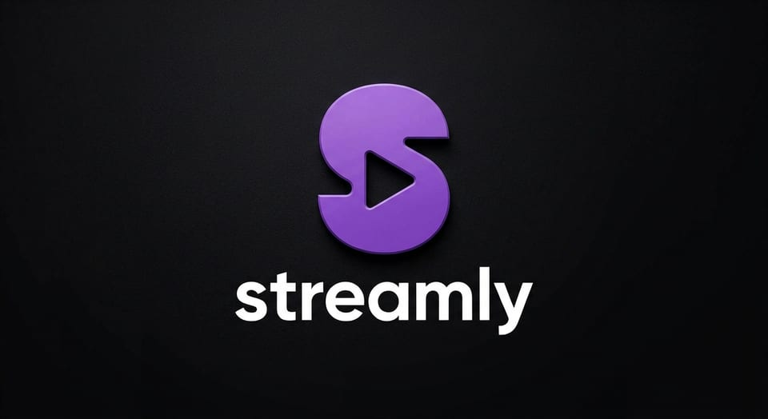

# STREAMLY

<p align="center"></p>

Proyecto desarrollado para la cursada 2026 de Metodologías Ágiles, UTN-FRLP.

## Integrantes - Grupo N° 6

- Sofia Lara Goszko
- Silvia Romero
- Pablo Rella
- Joaquin Montes
- Pedro Fiuza

## ¿Qué es?

Un buscador unificado que permite encontrar cualquier película o serie y saber, en un solo lugar, en qué plataforma de streaming está disponible según la región geográfica del usuario, con redireccionamiento directo a esa plataforma para empezar a ver el contenido.

## ¿Para quién?

Consumidores habituales de streaming que tienen 2 o más suscripciones activas (Netflix, Disney+, HBO Max, Prime Video, etc.) y que experimentan fricción real al decidir qué ver: saltan entre apps, no recuerdan en cuál tienen un título, o se topan con bloqueos regionales inesperados.

## Requisitos

- Node >= 22.23.2 y npm >= 11

## Puesta en marcha

```bash
npm install
npm run dev     # API en :3000 y web en :5173
npm run check   # lint + formato + tests
```

Copiar `apps/api/.env.example` como `apps/api/.env` y completar las claves de Supabase (las pasa quien administra el proyecto) y `TMDB_API_KEY`. El resto de las variables son para funciones puntuales:

- `STREAMING_AVAILABILITY_API_KEY`: deep links de la ficha y sincronización diaria de disponibilidad.
- `RESEND_API_KEY` y `RESEND_FROM`: mails de avisos de la watchlist.
- `SMTP_*` y `MAIL_FROM`: mails de la cuenta (recuperar la contraseña y cambiar el mail).

Los jobs programados (`syncAvailability` y `sendNotifications`) corren solo con `NODE_CRON_RUN=true`, en una sola instancia del despliegue; por defecto quedan desactivados. En local se ejecutan a mano con `npm run job -w apps/api -- <nombre>`. El detalle está en [apps/api/README.md](apps/api/README.md).

## Estructura

Monorepo con npm workspaces, en JavaScript (sin TypeScript).

```
apps/
  api/        Express 5: routes → controllers → services → repositories / integrations
  web/        React 19 + Vite + Tailwind CSS v4, organizado por funcionalidad (features/)
packages/
  shared/     Esquemas Zod y constantes que usan la API y la web
supabase/
  migrations/ Esquema de la base
```

- Los datos viven en Supabase y solo la API accede a ellos; la web habla únicamente con la API.
- Catálogo y disponibilidad: TMDB (con datos de JustWatch). Deep links a cada plataforma: Streaming Availability API.
- Las convenciones del proyecto (capas, nombres, idioma, commits) están en [AGENTS.md](./AGENTS.md).

## Pantallas

| Ruta                      | Sesión | Descripción                                                                                          |
| ------------------------- | :----: | ---------------------------------------------------------------------------------------------------- |
| `/`                       |        | Búsqueda de películas y series                                                                       |
| `/titulos/:tipo/:tmdbId`  |        | Detalle de un título con su disponibilidad en la región y, con sesión, la comparación entre regiones |
| `/watchlist`              |   sí   | Títulos guardados por el usuario                                                                     |
| `/mis-plataformas`        |   sí   | Elegir las plataformas contratadas                                                                   |
| `/perfil`                 |   sí   | Mail y región de la cuenta, plataformas propias y accesos a las acciones de cuenta                   |
| `/perfil/cuenta`          |   sí   | Cambiar el mail, cambiar la contraseña y eliminar la cuenta                                          |
| `/iniciar-sesion`         |        | Inicio de sesión (solo sin sesión)                                                                   |
| `/registro`               |        | Registro (solo sin sesión)                                                                           |
| `/recuperar-contrasena`   |        | Pedir un enlace por mail para restablecer la contraseña (solo sin sesión)                            |
| `/restablecer-contrasena` |        | Elegir una contraseña nueva desde el enlace del mail                                                 |
| `/confirmar-mail`         |        | Confirmar el cambio de mail desde el enlace del mail                                                 |

La nav del header lleva a «Mi watchlist», «Mis plataformas» y «Perfil». Sin sesión, `/watchlist`
invita a iniciar sesión. Con sesión, el avatar abre un menú con «Perfil» y «Cerrar sesión». En el
perfil, las plataformas se editan con el mismo listado que en `/mis-plataformas`, y las acciones de
cuenta llevan a cada sección de `/perfil/cuenta`. Los enlaces que llegan por mail vencen a los 30
minutos. Eliminar la cuenta borra al usuario y todos sus datos.

## Endpoints

Todas las rutas empiezan con `/api`. Las respuestas exitosas tienen la forma `{ "data": ... }` y los errores `{ "error": { "code", "message" } }`.

La pantalla de detalle también muestra la disponibilidad de TMDB/JustWatch para la región del usuario.
La API expone `GET /api/region`, que consulta la IP desde el backend y devuelve
`{ data: { region, source } }`. Con sesión también se usa la región de la IP, y si cambió se
guarda en `perfil.region`, que es la que usan los avisos de la watchlist. El servicio de país usado
es `https://api.country.is` y no requiere una clave nueva. Si no se puede detectar, usa la última
región guardada en el perfil (`source: "profile"`) o, sin sesión o sin región guardada,
`DEFAULT_REGION` con `source: "default"`, y la pantalla lo indica. En desarrollo local, la IP
suele ser local y se aplica ese respaldo. Si la API corre detrás de un proxy, configurar
`TRUST_PROXY` en `apps/api/.env` con las IPs o subredes CIDR de los proxies de confianza,
separadas por comas. Sin esa variable se detecta el país del proxy y no el del usuario. Las IPs
privadas o reservadas no se envían al servicio de país. `true` y `1` no son valores válidos para
`TRUST_PROXY`.

`GET /api/titulos/:tipo/:tmdbId/disponibilidad?region=BR` consulta la disponibilidad del país
indicado por el contexto de región y devuelve `{ region, ofertas, enlaceTmdb }`. Cada oferta agrupa
las plataformas activas por modalidad (`suscripcion`, `gratis` o `con_anuncios`); `enlaceTmdb` es
`null` cuando TMDB no informa un enlace para esa región. La ficha muestra las modalidades y el
enlace de TMDB cuando está disponible. Cada tarjeta lleva al título en la plataforma con un deep
link de Streaming Availability y, si no hay uno, a la home de la plataforma.

Con sesión, `GET /api/titulos/:tipo/:tmdbId/disponibilidad/comparacion?regiones=US,ES` devuelve
`{ regiones, regionesFallidas }` con la misma forma por región, para hasta 5 regiones. Usa solo los
deep links ya guardados y no gasta el cupo diario de Streaming Availability. Si falla una región,
va a `regionesFallidas` y el resto se devuelve igual.

La watchlist es del usuario de la sesión: `GET /api/watchlist?pagina=1` la lista y
`/api/watchlist/:tipo/:tmdbId` consulta (`GET`), agrega (`PUT`) o quita (`DELETE`) un título.
Cuando un título guardado pasa a estar disponible en la región del perfil, el usuario recibe un
aviso por mail (ver [apps/api/README.md](apps/api/README.md)).

| Método | Ruta                                                | Sesión | Descripción                                                                |
| ------ | --------------------------------------------------- | :----: | -------------------------------------------------------------------------- |
| GET    | `/health`                                           |        | Estado de la API                                                           |
| POST   | `/auth/sign-up`                                     |        | Registro con mail y contraseña                                             |
| POST   | `/auth/sign-in`                                     |        | Inicio de sesión (la sesión viaja en cookies httpOnly)                     |
| POST   | `/auth/sign-out`                                    |        | Cierre de sesión                                                           |
| GET    | `/auth/session`                                     |        | Usuario de la sesión actual, o `null`                                      |
| POST   | `/auth/password-recovery`                           |        | Manda por mail un enlace para restablecer la contraseña                    |
| POST   | `/auth/password-reset`                              |        | Restablece la contraseña con el token del enlace                           |
| POST   | `/auth/password-change`                             |   si   | Cambia la contraseña con la contraseña actual                              |
| POST   | `/auth/email-change`                                |   si   | Manda al mail nuevo un enlace para confirmar el cambio                     |
| POST   | `/auth/email-change/confirm`                        |        | Confirma el cambio de mail con el token del enlace                         |
| DELETE | `/auth/account`                                     |   si   | Elimina la cuenta y todos sus datos                                        |
| GET    | `/region`                                           |        | Región detectada del usuario                                               |
| GET    | `/busqueda`                                         |        | Busca películas y series con texto o filtros de catálogo                   |
| GET    | `/busqueda/generos`                                 |        | Lista géneros disponibles para filtrar películas y series                  |
| GET    | `/busqueda/personas`                                |        | Busca actores o directores. Query: `q` (mínimo 2 letras), `rol`            |
| GET    | `/busqueda/personas/:id`                            |        | Resuelve una persona por su ID. Query: `rol`                               |
| GET    | `/busqueda/propias`                                 |   si   | Búsqueda de títulos disponibles en las plataformas del usuario             |
| GET    | `/titulos/:tipo/:tmdbId`                            |        | Detalle de una película o serie (`tipo`: `pelicula` o `serie`)             |
| GET    | `/titulos/:tipo/:tmdbId/disponibilidad`             |        | Plataformas activas por modalidad y enlace de TMDB para la región indicada |
| GET    | `/titulos/:tipo/:tmdbId/disponibilidad/comparacion` |   si   | Disponibilidad en varias regiones. Query: `regiones` (separadas por coma)  |
| GET    | `/plataformas`                                      |        | Catálogo de plataformas activas                                            |
| GET    | `/plataformas/propias`                              |   si   | Ids de las plataformas que eligió el usuario                               |
| PUT    | `/plataformas/propias/:plataformaId`                |   si   | Agrega una plataforma propia                                               |
| DELETE | `/plataformas/propias/:plataformaId`                |   si   | Quita una plataforma propia                                                |
| GET    | `/watchlist`                                        |   si   | Títulos guardados del usuario, paginados. Query: `pagina`                  |
| GET    | `/watchlist/:tipo/:tmdbId`                          |   si   | Indica si el título está en la watchlist                                   |
| PUT    | `/watchlist/:tipo/:tmdbId`                          |   si   | Agrega un título a la watchlist                                            |
| DELETE | `/watchlist/:tipo/:tmdbId`                          |   si   | Quita un título de la watchlist                                            |

Los endpoints con sesión responden `401` (`UNAUTHENTICATED`) si no hay un usuario logueado.

En `/api/busqueda`, `q` se puede omitir cuando se indica `tipo`, `anio`, `genero`, `actor` o
`director`. En `/api/busqueda/propias`, la disponibilidad en las plataformas del usuario también
actúa como filtro y permite buscar sin texto. `genero` recibe el ID unificado de
`/api/busqueda/generos`; `actor` y `director` reciben identificadores de TMDB. Estos filtros se
combinan entre sí y con el texto, tipo y año de la consulta.
Si no se indica tipo, se aplican a películas y series con el ID de género que corresponde a cada
tipo. La búsqueda de personas recibe `rol=actor` o `rol=director`; la web conserva solo el ID en la
URL y consulta `/api/busqueda/personas/:id` para mostrar el nombre validado por la API. Las páginas
mantienen esos filtros. Cuando una página de texto no tiene coincidencias, la API revisa hasta tres
páginas consecutivas y la web permite continuar la búsqueda o limpiar los filtros.
`/api/busqueda/propias` combina esos filtros de catálogo con la disponibilidad de las plataformas
del usuario.
